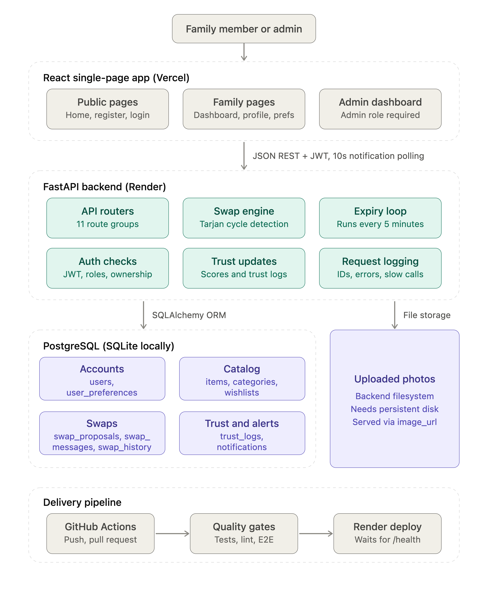
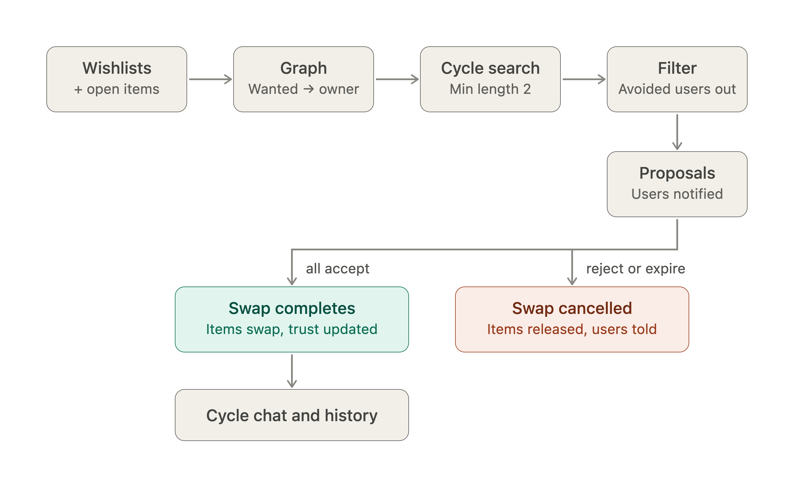
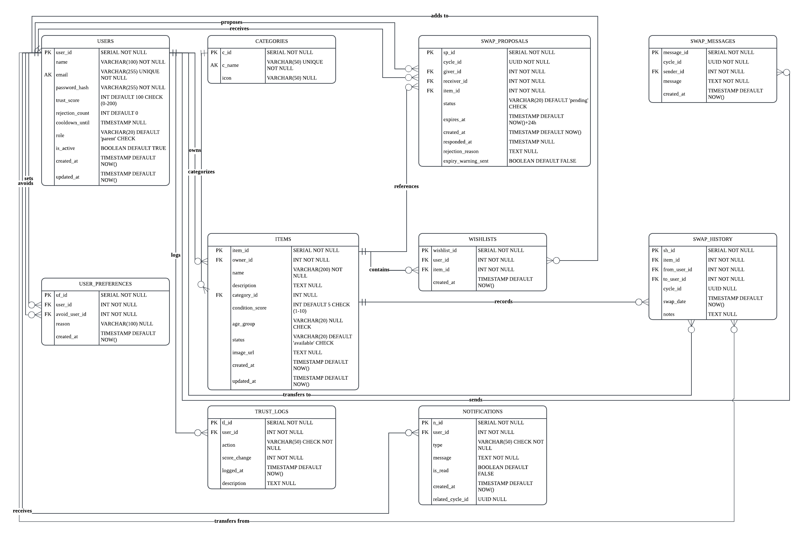

# Deliverables

Design documents and diagrams for EquiSwap, a wishlist-driven platform where families swap children's toys, books, and learning resources in multi-user cycles.

## Contents

| File | Description |
| --- | --- |
| [Architecture_diagram.txt](Architecture_diagram.txt) | Detailed text architecture: presentation, application, and storage layers, swap matching and lifecycle, authentication and trust, CI and deployment, and the end-to-end user journey. |
| [architecture_diagram_init.txt](architecture_diagram_init.txt) | Earlier, shorter summary of the architecture. Superseded by `Architecture_diagram.txt`. |
| [equiswap_system_architecture.png](equiswap_system_architecture.png) | System architecture diagram: React frontend on Vercel, FastAPI backend on Render, PostgreSQL, file storage, and the delivery pipeline. |
| [equiswap_swap_lifecycle.png](equiswap_swap_lifecycle.png) | Swap lifecycle: wishlists, graph, cycle search, filtering, proposals, then completion or cancellation, followed by cycle chat and history. |
| [ERD_EquiSwap.png](ERD_EquiSwap.png) | Entity relationship diagram for the database. |

## System architecture

- **Frontend:** React, Vite, and TypeScript single-page app hosted on Vercel.
- **Backend:** FastAPI with SQLAlchemy and JWT authentication, hosted on Render.
- **Database:** PostgreSQL on Render in deployment, SQLite for local development and tests.
- **Swap engine:** builds a directed graph from wishlists and available items, then finds cycles with Tarjan's strongly connected components algorithm.
- **Notifications:** the browser polls the REST endpoints every 10 seconds; there are no WebSockets.
- **Expiry:** a background task runs every 5 minutes to expire and warn about unresolved proposals.
- **Uploads:** item photos are files on the backend filesystem, so deployments need a persistent disk or external storage to keep them across restarts.

## Swap lifecycle

1. Wishlist entries and available items form a directed graph.
2. Cycle detection finds groups of at least two users, and avoided users are filtered out.
3. A user proposes a cycle, and every participant is notified.
4. If all participants accept, items change owner, trust scores update, and the swap is recorded in history.
5. If anyone rejects or the proposal expires, items are released and participants are notified.
6. Participants who have accepted can message each other in the cycle chat to agree a time and place.

## Database

Tables: `users`, `categories`, `items`, `wishlists`, `user_preferences`, `swap_proposals`, `swap_messages`, `swap_history`, `trust_logs`, and `notifications`. The SQL schema is in `EquiSwap/backend/database_create.sql`. The application creates missing tables at startup but does not alter existing ones, so schema changes on a deployed database need a migration, for example `EquiSwap/backend/database_migrate_swap_message_notifications.sql`.
